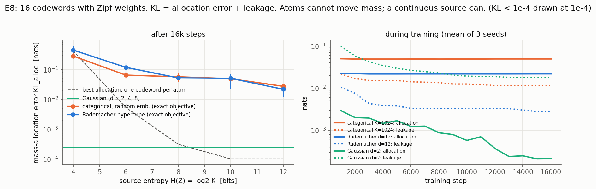
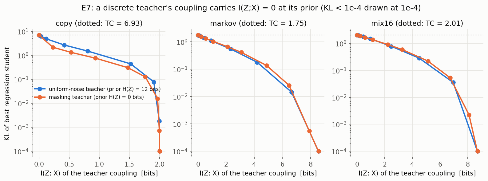

# why-one-step-is-continuous

**Why does every good one-step generator, including the discrete ones, get its randomness from
continuous noise?** This repo answers that with a small mechanism study in which every number is
exact: 6 positions × 4 tokens = 4,096 states, small enough to enumerate.

**Short answer:** bits are not the problem. Discrete noise with enough entropy *fits* the data as
well as or better than Gaussian noise. What it lacks is two kinds of continuity that one-step
*training* needs, plus geometry:

| what one-step training needs | continuous noise | discrete noise | evidence |
|---|---|---|---|
| **enough bits**: H(Z) ≥ log₂ rank(p) | ✓ | ✓ for uniform tokens (✗ for masks: KL = TC exactly) | E1, E2, E3 |
| **mass that can flow**: P(z ∈ mode) differentiable in θ | ✓ atomless | ✗ allocation error frozen from step 1k to 16k | E8 |
| **a deterministic noise→data transport** for teachers and couplings | ✓ probability-flow ODE | ✗ no flow on a finite set, so the teacher coupling has I(Z;X) = 0 | E7 |
| **geometry aligned with that transport**, to generalize to unseen z | ✓ | only if ordered (ordered 64-level ≈ continuous, shuffled = chance) | E4, E3 (n = 500) |



*E8. Each KL is split exactly into mass-allocation error and leakage. Atomic sources get the mode
weights wrong in the first 1k steps and never fix them (flat lines). A Gaussian source drives
allocation error to 2e-4, and its remaining error is boundary leakage, which keeps shrinking.*



*E7, computed exactly. A discrete diffusion teacher's coupling with its own 12-bit prior noise
carries I(Z;X) = 0. The best student distilled from it is a product distribution (KL = TC), the
same as using no noise at all.*

The full write-up, with every figure, table, caveat, and the hypothesis-by-hypothesis verdicts, is
in **[REPORT.md](REPORT.md)**. The original study plan is
[one_step_discrete_plan.md](one_step_discrete_plan.md).

## Verdicts on the plan's hypotheses

* **H1 (rank)**: confirmed exactly. KL = TC at k = 1 and 0 at k = r.
* **H2 (steps as shared randomness)**: confirmed exactly. MDM k-step laws computed by enumeration.
* **H3 (shared decision boundaries)**: supported. Correlated positions co-flip far more than
  chance (6.7–8.3×), with ρ = 0.65–0.85 against mutual information. It also holds for hypercube sources, so it is
  not unique to continuous noise.
* **H4 (geometry ⇒ discrete as good as Gaussian; structureless ⇒ worse)**: **falsified for
  fitting** (structureless atoms fit *best*). **Supported for generalization and for learning a
  coupling**, where unordered sources fall to chance.

## Experiments

| | question | script | time (RTX 5060 laptop) |
|---|---|---|---|
| E1 | rank threshold (EM) | `sweeps/e1_rank.py` | 15 min |
| E2 | k-step masked diffusion, exact laws | `sweeps/e2_steps.py` | 5 min |
| E3 | source sweep, population and n = 500 | `sweeps/e3_sources.py`, `sweeps/e3_budget.py` | ~3 h |
| E4 | coupling learnability (ODE / OT / VAE / KR × source) | `sweeps/e4_coupling.py` | 40 min |
| E5 | do correlated positions flip together? (toy) | `sweeps/e5_boundaries.py` | 10 min |
| E6 | MC marginal likelihood vs samples per step | `sweeps/e6_nscaling.py` | 25 min |
| E7 | information in a discrete teacher's coupling (exact) | `sweeps/e7_teacher_coupling.py` | 1 min |
| E8 | can mass move between modes? | `sweeps/e8_mass.py` | 40 min |

```bash
cd onestep-discrete
python sweeps/e7_teacher_coupling.py     # fastest result: exact, about 1 minute
python run.py --data mix16 --source gaussian --d 4   # one config -> one JSON in results/
python plots.py                           # every figure, from results/*.json only
```

Requirements: Python ≥ 3.10, PyTorch ≥ 2.0 (CUDA optional), SciPy, Matplotlib.

## Layout

```
onestep-discrete/
  data.py      data families, exact p(x), TC, KL
  sources.py   every P_Z: gaussian, uniform, quantized, rademacher, shuffled, onehot, categorical
  model.py     MLP z -> L x V logits
  losses.py    MC marginal likelihood, regression CE
  exact.py     exact / large-N marginal of a one-step generator; KL = allocation + leakage
  run.py       one config -> one JSON (resumable)
  sweeps/      E1-E8
  plots.py     figures from JSONs only
  results/     JSONs of every run reported here
  figures/
REPORT.md      the write-up
```

## Method notes

* One generator (MLP, 3 layers, width 256) and one objective for every source:
  −Σₓ w(x) log (1/N) Σₙ ∏ᵢ p_θ(xᵢ | zₙ) with N = 256 fresh samples per step. Only P_Z changes.
* Every reported KL is exact by enumeration. The exceptions are sources with more than 2¹⁶ atoms
  and continuous sources, which use a 2¹⁶-sample MC estimate (bias < 1%, checked).
* The code was reviewed twice by an independent agent. The verified findings were fixed and
  re-run, and the git history is the research log.
