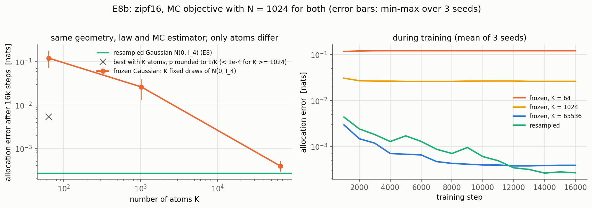
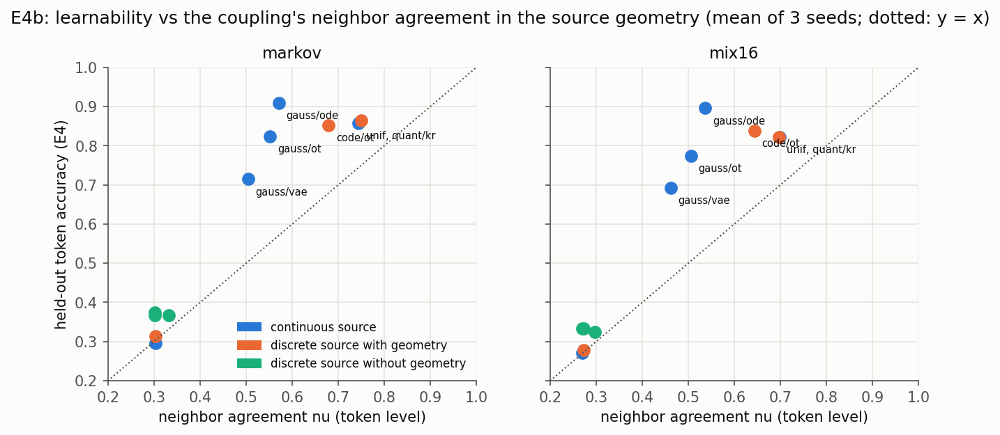

# Why one-step generators get their randomness from continuous noise

*A small mechanism study with exact metrics. V = 4 tokens, L = 6 positions, 4,096 states, so every
distribution is enumerated (no FID, no perplexity). Plan: [`one_step_discrete_plan.md`](one_step_discrete_plan.md).*

## The question

A one-step generator draws a source sample Z, runs one forward pass, and samples every position
independently: p_θ(x) = E_Z ∏ᵢ p_θ(xᵢ | Z). Every correlation between positions must be carried
by Z. Every one-step generator that works well gets Z from **continuous** noise. So:

> What exactly is missing from a discrete source of randomness? How much of it is
> information theory (a hard limit), and how much is geometry and optimization (a soft limit)?

## The answer

Information theory gives a hard limit, and it is real but cheap. A uniform source needs at least
rank(p) atoms, i.e. log₂K ≥ log₂ rank bits. (For non-uniform sources the general Shannon bound is
Wyner's common information, which is ≤ log₂ rank.) Below that every source fails alike. Above it,
**representation is not the problem**: the plan's main conjecture H4 is falsified as stated
(Preliminaries). What discrete noise lacks is what one-step *training* relies on. Each of the three
pieces below is one proposition with one figure.

1. **② A deterministic noise → data coupling to learn from (Propositions A, B′; E7, E7b, E7c).**
   At scale, one-step generators regress onto a coupling (z, x) from a teacher or an encoder
   (the likelihood needs ~2^I(X;Z) source samples per step, appendix E6). For *any* coupling, the
   regression-optimal student's error is at most E_z TC(X | Z=z) = TC(X) − [Σᵢ I(Z;Xᵢ) − I(Z;X)],
   which is zero for a deterministic coupling. Marginalizing a path between independent noise and
   data gives a deterministic coupling in continuous space (ODE solutions are unique), and a
   stochastic one in finite space (a rate matrix lets one state jump to several targets):
   * reversed discrete noising chain from its prior: I(Z;X) = 0, student KL = TC(p);
   * exact Discrete Flow Matching teacher: ~1.3 of ~8.6 bits on mix16 and Markov, student KL
     1.07–1.41 nats (copy: 0.64 of 2 bits, 2.14 nats);
   * continuous FM teacher + ODE + argmax, *measured* in the same harness: I(Z;X) = H(T(Z)),
     trained student's KL to the teacher's law 0.020–0.023 nats, 50–61× below the DFM student.
2. **① Mass that can move between modes (Propositions B, C; E8, E8b).** With a continuous source,
   mode masses are P(z ∈ region_θ) and move by boundary flux. With K atoms they are multiples of
   1/K and piecewise constant in θ. Holding the geometry, law and MC estimator fixed (frozen vs
   resampled Gaussian), atoms alone freeze the allocation: K = 64 sits at 0.12 nats from step 1k to
   16k (23× its 1/K-grid optimum). K = 1024 sits at 0.026 (> 10³× its optimum). K = 2¹⁶ reaches
   4·10⁻⁴, as does the resampled Gaussian (3·10⁻⁴).
3. **③ Geometry aligned with the coupling, so it is learnable on unseen z (E4, E4b).** Discreteness
   itself costs nothing: an ordered 64-level grid matches continuous uniforms (held-out token
   accuracy 0.865 vs 0.858 on Markov). The *same source law* with shuffled levels falls to the
   z-independent baseline. The neighbor agreement ν of the coupling in the source geometry
   separates the two regimes: at chance ν (0.27–0.33) every coupling generalizes at the baseline,
   and above it accuracy rises with ν (Spearman 0.85 over 22 cells), though not on one curve.

So "one-step should be continuous" means: the training coupling should come from a
**deterministic transport**, which continuous-state marginalization provides for free and
discrete marginalization does not; the source should be **atomless** so mass can flow; and the
noise needs **geometry aligned with that transport**. Continuous noise gives all three for free.
Discrete noise supplies bits, but none of these by default.

| | hard (information) | soft (optimization / geometry) |
|---|---|---|
| what limits | K ≥ rank(p) atoms for a uniform source (Wyner's common information in general). Below it every source fails (E1, E3). | information *in the training coupling* (Prop. A, E7); mass allocation (Props. B, C, E8); coupling learnability (E4) |
| binding in practice? | only for mask-type noise (H(Z) = 0 ⇒ KL = TC exactly) | yes: these separate discrete from continuous |
| continuous noise fixes it by | n/a | ODE ⇒ deterministic coupling; atomless source ⇒ mass moves with boundaries; metric ⇒ smooth coupling |

Note one subtlety. ② *is* information-theoretic, but the binding quantity is the conditional total
correlation of the **training coupling**, not the entropy H(Z) of the source.

---

## Setup (shared harness)

* **Data**:
  * `mix<r>`: uniform mixture of r random product distributions, Dirichlet(0.2) rows, so
    I(C;X) ≈ log₂ r;
  * `markov`: first-order chain;
  * `copy`: x₁ = … = x₆;
  * `code<r>`: r codewords of the distance-2 parity code, so rank = r exactly;
  * `zipf16`: 16 such codewords with Zipf weights.
* **Generator**: MLP z → 256 → 256 → 6×4 logits, SiLU, Adam 1e-3 with cosine decay.
* **Objective** (identical for every source within an experiment): −Σₓ w(x) log (1/N) Σₙ ∏ᵢ p_θ(xᵢ|zₙ),
  with w = p (population) or the empirical distribution of n samples. E3 uses N = 256 fresh source
  samples per step; E3b, E6, E8, and E8b vary N or enumerate all atoms, as stated. E4 and E7c
  instead use supervised regression (CE) on (z, x) pairs.
* **Metrics**: KL(p‖p_θ), TV, TC(p_θ). They are exact for finite sources with K ≤ 2¹⁶ atoms. For
  continuous sources and larger K (including the H = 32 discrete sources) we use a 2¹⁶-sample MC
  estimate. Re-evaluating 151 MC runs with
  2¹⁴ samples changes KL by a median of 0.5% (90th percentile 3%, max 10%), i.e. an implied bias
  of ≤ 3.4% (median 0.2%).
* Each run writes one JSON (config, metrics, trajectory, wall time). Figures are built from the
  JSONs only (`onestep-discrete/plots.py`). E3b and E6 use one seed, E7 and E7b are exact computations,
  and everything else uses 3 seeds.

## Preliminaries (H1, H2, H4)

A k-component mixture of products fits p exactly iff k ≥ rank₊(p) (H1, confirmed by EM in E1:
KL = TC at k = 1, ≤ 3·10⁻⁶ for k > r). A k-step masked-diffusion sampler manufactures its own
shared randomness: at k = 1 the all-mask source has H(Z) = 0 and KL = TC exactly; each step adds
committed tokens (H2, confirmed exactly in E2; cf. the factorization error of one-step MDM sampling).
Once H(Z) passes the threshold, **representation stops being the bottleneck**. On mix16 every
source fails alike below log₂ 16 = 4 bits, and above it the best fits come from *well-separated
atoms* (one-hot, categorical K = 256, Rademacher: 0.0004–0.014 nats), not from Gaussian (0.055)
(E3). Details, the budget check (E3b) and generalization are in the appendix.


---

## ② The coupling: a one-step student inherits the coupling's conditional dependence

**Proposition A.** Let π(z, x) be any coupling with X-marginal π_X, and let the one-step student be
regression-optimal, q(xᵢ | z) = π(xᵢ | z), so p_G(x) = Σ_z π(z) ∏ᵢ π(xᵢ | z). Then

$$\mathrm{KL}(\pi_X\,\|\,p_G)\;\le\;\mathbb E_z\,TC(X\mid Z=z)\;=\;TC(X)-\Big[\textstyle\sum_i I(Z;X_i)-I(Z;X)\Big].$$

*Proof.* A KL between marginals is at most the KL between the joints π(z, x) and π(z) ∏ᵢ π(xᵢ|z),
which is E_z KL(π(·|z) ‖ ∏ᵢ π(xᵢ|z)) = E_z TC(X|Z=z). Expanding,
Σᵢ H(Xᵢ|Z) − H(X|Z) = Σᵢ H(Xᵢ) − Σᵢ I(Z;Xᵢ) − H(X) + I(Z;X). ∎

*Consequences.* The bound is 0 iff the coupling is conditionally independent across positions given
z. A deterministic coupling x = T(z) is the simplest such case, and then the student is exact. (The
converse can fail: the marginal KL can vanish while the bound does not.) At I(Z;X) = 0 the bound is
TC(X) and is attained. The quantity that matters is how much each *position* learns from z,
Σᵢ I(Z;Xᵢ), net of I(Z;X), and not H(Z).

**Proposition B′ (why marginalized teachers differ).** A teacher is built by averaging conditional
dynamics over an independent coupling of noise and data. In ℝⁿ the average is a velocity field
whose ODE has unique solutions, so the endpoint map is deterministic and the bound of Prop. A is 0.
(Continuous diffusion's SDE sampler is as uninformative as the reversed chain, I(Z_T; X₀) → 0, but
its probability-flow ODE has the same marginals and a deterministic coupling. That is what
consistency models, flow maps, MeanFlow, FMLM, and Duo distill.) In a finite space the average is a
jump-rate matrix: one state can have several exits, so the endpoint is random given the start.

We compute everything exactly for three teacher families:

* **E7: forward joints** π(z, x) = p(x) ∏ᵢ k_α(zᵢ|xᵢ) with uniform or masking kernels. At α = 0
  this is the time-reversed noising chain started from its prior. For α > 0 it corresponds to
  starting the reversed chain from the α-marginal, which is *not* the prior.
* **E7b: Discrete Flow Matching teacher.** This is the marginal CTMC of the mixture path, started
  from Uniform(V^L), with rates P(X₁ᵢ = y | X_t)/(1−t). We integrate the forward Kolmogorov equation
  for the joint of (X₀, X_t) over all 4,096 × 4,096 pairs (Euler in s = −log(1−t), step 0.0025).
  The marginal matches p_t to ≤ 9·10⁻⁴ TV, checked every 20 steps. Doubling the step changes the
  student KL by ≤ 0.0073 nats and I by ≤ 0.005 bits.
* **E7c: continuous FM teacher.** E4's one-hot flow-matching model, z ~ N(0, I₂₄), Euler ODE
  (100 steps), then argmax: T(z) is deterministic, so I(Z;X) = H(T(Z)) and the bound is 0. The
  student is fit by CE on a pool of 2²² (z, T(z)) pairs (1,280× E4's 3,276) and tested on fresh
  z. Its error is the KL to the teacher's own law p_T, the analog of E7's KL to π_X = p, with the
  same 2¹⁶-sample MC estimate of p_G as every continuous source. 3 seeds; the teacher is good on
  Markov (TV(p, p_T) = 0.07) and imperfect on mix16 (0.29, velocity-fit error, see Limitations).
  Its law is more spread than p, so H(T(Z)) exceeds H(p) (by 0.27 / 1.09 bits).


| teacher (prior noise) | H(Z) | I(Z;X): mix16 / markov / copy | student KL: mix16 / markov / copy |
|---|---|---|---|
| reversed noising chain (uniform prior) | 12 bits | **0 / 0 / 0** | 2.013 / 1.753 / 6.931 (= TC) |
| reversed masking chain (all-mask prior) | 0 bits | 0 / 0 / 0 | = TC |
| DFM marginal CTMC (uniform prior) | 12 bits | 1.31 / 1.25 / 0.64 | 1.41 / 1.07 / 2.14 |
| continuous FM + ODE + argmax (E7c, mean of 3 seeds) | continuous | **H(p_T) = 9.79 / 8.82** / – | **0.023 / 0.021** / – to p_T (0.33 / 0.048 to p) |

* **The bound holds on all 60 forward-joint points and the DFM points.** It is attained at I = 0
  and at α = 1, and is loose in between (KL / bound down to 0.04–0.14).
* **It explains the DFM offset.** At equal I(Z;X) the DFM students sit 8–10% above the
  forward-joint curves on mix16 and Markov. At equal *bound* they sit 0.6–3.4% below. A DFM
  coupling gives each position less information for the same joint information
  (Σᵢ I(Z;Xᵢ) = 1.68 bits vs ~1.80 on the curves at I = 1.31, mix16).
* **It does not explain copy's kernel gap.** On copy every Xᵢ determines X, so
  Σᵢ I(Z;Xᵢ) = L · I(Z;X) for every coupling and the bound depends on I alone. The masking kernel's
  1.2–1.7× advantage at equal I therefore lies entirely in the slack of the first inequality, how
  the per-z errors average out in the mixture. We leave it unexplained.
* **Continuous closes the gap.** The same harness with a continuous ODE teacher gives a
  deterministic coupling and a trained-student error of 0.020–0.023 nats (3 seeds), 50–61× below
  the exact DFM teacher. Prop. A gives 0 for the regression-optimal student, so what remains is
  the trained student's boundary-fitting error (held-out token accuracy 0.97–0.98) plus MC
  evaluation noise, not information. Even against p, through an imperfect
  teacher, the mix16 student (0.33) is 4× better than the DFM student.
* Deterministic discrete couplings exist, but they must be built rather than inherited:
  E4's inverse-CDF (KR) map, which moves a multi-step sampler's per-step uniforms into Z; OT
  assignments; CTMCs whose state remembers the start (an independent reviewer gave one that maps
  uniform noise to `copy` deterministically); iterative rectification as in ReDi. They are only
  learnable when the source geometry is aligned with them (③).

## ① Mass: atoms cannot move it, a density can

On `zipf16`, the exact KL splits as **allocation error** (KL of p against p_θ restricted to the
codewords and renormalized) plus **leakage** (−log p_θ(codewords)).

**Proposition B (the 1/K lattice).** If a generator maps K ≥ |supp p| equal-weight atoms
deterministically to states, then p_G(x) = n_x / K with integer n_x, and

$$\min \mathrm{KL}(p\,\|\,p_G) \;=\; \min_{n_c \ge 1,\ \sum n_c = K}\ \sum_c p_c \log\frac{p_c K}{n_c},$$

the KL of p rounded to the 1/K grid. The objective is separable and convex in the integers, so
greedy allocation is exact. For soft (non-deterministic) outputs this is an upper bound on the best
KL, not a floor (two K = 16 seeds in E8 beat it by spreading atoms over codewords).

**Proposition C (flux).** For a source with density ρ and a region R_c(θ) whose boundary moves
smoothly with θ, the Reynolds transport theorem gives
∂_θ P(Z ∈ R_c(θ)) = ∫_{∂R_c} ρ(z) v_n(z) dS, where v_n is the boundary's outward normal velocity: mass
flows wherever there is density on the boundary. For an atomic source,
P(Z ∈ R_c(θ)) = #{k : z_k ∈ R_c(θ)} / K is piecewise constant in θ, with zero derivative almost
everywhere. With softmax outputs the mass is differentiable, but moving an atom between codewords
(Hamming distance ≥ 2) crosses product distributions that leak onto non-codewords, a loss barrier,
and saturated atoms have vanishing gradients.

**E8** trains finite sources with the *exact* enumerated objective (the most favorable case) and
Gaussians with MC, N = 1,024; 16k steps, 3 seeds.


| source | total KL | Prop. B optimum with K atoms | allocation @1k → @16k | leakage @1k → @16k |
|---|---|---|---|---|
| categorical K = 16 / 64 / 256 / 1024 / 4096 | 0.454 / 0.065 / 0.059 / 0.060 / 0.036 | 0.41 / 0.0054 / 3·10⁻⁴ / 2·10⁻⁵ / 10⁻⁶ | 0.28 / 0.065 / 0.055 / 0.049 / 0.028 → same ±6% | 0.17 / 0.000 / 0.011 / 0.022 / 0.021 → 0.17 / 0.000 / 0.003 / 0.011 / 0.008 |
| Rademacher d = 4 / 6 / 8 / 10 / 12 | 0.659 / 0.123 / 0.055 / 0.052 / 0.024 | same as K = 2^d | 0.45 / 0.12 / 0.053 / 0.050 / 0.022 → same ±6% | 0.21 / 0.006 / 0.006 / 0.006 / 0.010 → 0.21 / 0.005 / 0.003 / 0.001 / 0.003 |
| Gaussian d = 2 / 4 / 8 | **0.018 / 0.027 / 0.027** | n/a | 0.003 / 0.004 / 0.005 → **0.0002 / 0.0003 / 0.0003** | 0.10 / 0.12 / 0.13 → 0.018 / 0.027 / 0.026 |

E8 differs from Gaussian in three ways at once: atoms, geometry, and exact vs MC gradients.
**E8b** removes the last two. A *frozen Gaussian* (K draws of N(0, I₄), fixed once) is
compared with the resampled N(0, I₄) of E8, both trained with the same MC objective (N = 1,024
draws per step, from the atoms or from the density). The only difference is whether the source has
atoms.



| allocation error (nats, mean of 3 seeds) | @1k | @16k | Prop. B optimum |
|---|---|---|---|
| frozen K = 64 | 0.117 | **0.121** (seeds 0.07–0.18) | 0.0054 |
| frozen K = 1024 | 0.031 | 0.026 | 2·10⁻⁵ |
| frozen K = 2¹⁶ | 0.0029 | **0.0004** | 6·10⁻⁹ |
| resampled N(0, I₄) | 0.0044 | **0.0003** | n/a |

* **Atomicity alone freezes the allocation.** With 64 atoms it does not move in 15k steps and
  stays 23× above what the atoms allow. With 1024 it drifts slowly. With 2¹⁶ atoms (K = 64 N; each atom
  is drawn ~250 times in all of training) the source behaves like the density. At this
  budget atomicity binds up to K ~ 10³.
* Finite sources in E8 likewise settle their allocation in the first 1k steps and then move it by
  ±6%. For K ≥ 64 their total KL is 12× (K = 64) to more than 10⁴× (K = 4096) above the Prop. B
  optimum.
* The Gaussian's residual allocation error (~2·10⁻⁴) is about half evaluation noise: the
  multinomial bias of a 2¹⁶-sample estimate over 16 modes is ≈1.1·10⁻⁴. All its remaining error is
  boundary leakage, which keeps shrinking. On total KL, Gaussian d = 2 (0.018) beats every finite
  source in E8. The same atomic picture appears as EM local optima at k = r (E1) and as stuck exact
  objectives (E6).

## ③ Geometry: a coupling is learnable iff it is smooth in the source geometry

**E4.** Fit G by regression (CE) on 3,276 fixed (z, x) pairs; test on 820 held-out z (pairs shuffled
before the split).

* "code" = 4,096 symbols written as per-position tokens, the representation of uniform-diffusion
  noise.
* "kr" = the Knothe–Rosenblatt map: an autoregressive inverse-CDF sampler driven by u ∈ [0,1]⁶,
  i.e. a discrete multi-step sampler whose randomness has been moved into Z.
* Reference points: matching an independent sample gives 0.30 / 0.27 (markov / mix16); the best
  z-independent predictor (per-position majority token) gives 0.38 / 0.35.


| held-out token acc (markov / mix16) | random | VAE | OT | ODE | KR |
|---|---|---|---|---|---|
| Gaussian / uniform (continuous) | 0.30 / 0.27 | 0.71 / 0.69 | 0.82 / 0.77 | **0.91 / 0.90** | 0.86 / 0.82 |
| code (discrete tokens, Hamming-OT) | 0.31 / 0.28 | | **0.85 / 0.84** | | |
| quantized u, 64 ordered levels (discrete) | | | | | **0.87 / 0.82** |
| one-hot symbols (no geometry) | 0.37 / 0.33 | | 0.37 / 0.33 | | |
| shuffled u levels (same law as quantized) | | | | | **0.37 / 0.33** |

* **Discreteness is free.** Ordered 64-level u ≈ continuous u, and Hamming-OT code ≈ Gaussian OT.
* **Geometry is not free.** The *same pairs* fed through one-hot symbols, or the *same source law*
  with shuffled levels, fall to the z-independent baseline on held-out z. At scale the generator
  never sees most z, so this is decisive.
* The plan predicted ODE ≈ VAE > Hamming-OT > random; observed is ODE > Hamming-OT ≈ Gaussian OT >
  VAE > random. The simplified VAE coupling is the weakest geometric one.

**E4b (no training).** As a discrete Lipschitz proxy for the coupling T, let the **neighbor
agreement** ν be the fraction of positions on which T(z) and T(z′) agree, where z′ is z's nearest
other source point in the geometry G sees (exact Euclidean distance on G's input, random
tie-breaking, all 4,096 pairs of each cell). The pairs are rebuilt from E4's seeds (target
histograms match E4 exactly; the VAE teacher is retrained from the same seed), and the accuracies
are E4's.



* **ν at chance ⇒ no generalization.** Every geometry-free cell (random pairs, one-hot symbols,
  shuffled levels) has ν = 0.27–0.33, near the agreement of independent draws (0.27 / 0.30 on
  mix16 / Markov), and held-out accuracy at the z-independent baseline (≤ 0.38). Every geometric cell has ν ≥ 0.46 and accuracy ≥ 0.69.
* **Within a geometry, ν orders learnability exactly**: Gaussian VAE < OT < ODE in both ν
  (0.50 < 0.55 < 0.57 on Markov) and accuracy (0.71 < 0.82 < 0.91). Across all 22 cells,
  Spearman 0.85 and Pearson 0.93.
* **Not one curve.** The 24-D Gaussian ODE cell (ν 0.57, acc 0.91) beats the 6-D KR cells
  (ν 0.74, acc 0.86). With 4,096 points, nearest neighbors in ℝ²⁴ are far apart, so this
  finite-sample ν understates how smooth T is locally. ③ is therefore "learnability needs ν above
  chance and grows with it", not "ν determines learnability".

---

## What this means for building one-step discrete generators

* **Bits are not the issue.** Uniform-token noise has L·log₂V bits, far more than needed.
  Mask-type noise has 0 bits, which is why one-step MDM sampling is a product (KL = TC).
* **Learn from a deterministic transport, and put the noise where mass can move.** Continuous noise
  with an ODE-derived coupling provides both. This is why FMLM, Categorical Flow Maps, Duo (argmax
  of a Gaussian diffusion), and Coupling Models (Gaussian latent → factorized decoder) work.
* **A marginalized discrete teacher is a weak source of couplings.** By Prop. A its student is
  limited by E_z TC(X|Z=z). The reversed chain gives I(Z;X) = 0 at the prior, and even an exact DFM
  teacher keeps only ~1.3 of ~8.6 bits. Build the coupling instead (OT, inverse-CDF,
  rectification).
* **If the noise must be discrete, make it dense and ordered, aligned with the coupling.**
  Quantized uniforms driving an inverse-CDF sampler, or Hamming-OT-aligned tokens, are as learnable
  as continuous noise. Unordered symbols are not. Use many atoms (≫ 10³ here) so that mass can
  still move.

## Limitations

* Toy scale: L = 6, V = 4, one MLP architecture, fixed budgets (4k–16k steps). Effects that only
  appear at scale (attention, long sequences) are not tested.
* E3b and E6 use one seed. E7b is deterministic; its Euler discretization moves the reported
  numbers by ≤ 0.0073 nats and ≤ 0.005 bits.
* E4 trains G on 3,276 pairs, so its deployed KL is dominated by memorization and the held-out law
  uses only 820 atoms for code/one-hot. We report held-out accuracy as the learnability metric.
  The FM teacher of E4/E7c is imperfect on mix16 (target TV 0.36 vs a 0.18 sampling floor); an
  independent check traced this to velocity-fit error, not the ODE. E7c therefore reports the
  student's KL to the teacher's own law, plus the KL to p.
* E4b's ν is a finite-sample proxy; its scale depends on the source dimension (see ③).
* E8 and E8b use one data family (Zipf-weighted codewords) and E8b one source dimension (d = 4).
  The mechanism is general; the magnitudes and the K ~ 10³ crossover are specific.
* The E5 real-model probe (FMLM on LM1B) was not run.

## Reproduce

```bash
cd onestep-discrete            # any env with torch>=2.0 (CUDA optional), scipy, matplotlib
python sweeps/e1_rank.py       # E1  EM rank sweep               (~15 min GPU)
python sweeps/e2_steps.py      # E2  MDM k-step exact laws        (~5 min)
python sweeps/e3_sources.py --data mix16 --n_train 0     # E3 (~1.5 h; --worker/--nworkers to shard)
python sweeps/e3_sources.py --data mix16 --n_train 500
python sweeps/e3_budget.py     # E3b budget / N check
python sweeps/e4_coupling.py   # E4  coupling learnability        (~40 min; caches FM/VAE teachers)
python sweeps/e4b_neighbors.py # E4b neighbor agreement nu        (no training beyond the cached teachers)
python sweeps/e5_boundaries.py # E5  toy boundary probe
python sweeps/e6_nscaling.py   # E6  objective vs N
python sweeps/e7_teacher_coupling.py  # E7 exact, with Prop. A's bound, ~1 min
python sweeps/e7b_dfm.py       # E7b exact DFM teacher coupling   (~15 min)
python sweeps/e7c_ode_teacher.py  # E7c continuous ODE teacher point (~20 min)
python sweeps/e8_mass.py       # E8  mass allocation              (~40 min)
python sweeps/e8b_frozen.py    # E8b frozen vs resampled Gaussian (~5 min)
python plots.py                # all figures from results/*.json
```

The first-round code and report were checked four times by an independent agent, the last pass
a full fact-check of every number against the JSONs. Every verified finding was fixed; the fixes
include an E4 split order, categorical standardization, codebook rank, the DFM teacher (added in
response), the framing of the mass argument, and plotting. Affected experiments were re-run. The
second round (Props. A–C, E4b, E7c, E8b) followed an external review. The git history is the
research log.

---

## Appendix

### A1. H1: rank threshold (E1)

Population EM for a k-component mixture of products, best of 10 restarts.


* At k = 1, KL = TC(p) to machine precision (mix16: 2.012882 vs 2.012882). The neural generator
  with a constant source gives the same to < 1e-4 on mix16, markov, and copy.
* KL falls until k = r and is ≤ 3·10⁻⁶ for every k > r. At k = r exactly it is ~0 for
  r = 2, 4, 16 but 0.003 for mix64: EM local optima.
* Single restarts at k = r often get stuck (mix16: 0.03–0.11), while k = 1.5r reaches 0 from
  every restart. Assigning mass to components is already the hard part (①).

### A2. H2: steps are self-made shared randomness (E2)

A masked-diffusion MLP is trained on each family. The k-step sampler's law is computed **exactly**
by summing over all ordered unmasking partitions. The oracle uses p's exact conditionals.


| KL (nats), MDM / oracle | k=1 | k=2 | k=3 | k=6 |
|---|---|---|---|---|
| markov | 1.753 / 1.753 | 0.352 / 0.349 | 0.114 / 0.111 | 0.0006 / 0 |
| copy | 6.931 / 6.931 | 2.773 / 2.773 | 1.386 / 1.386 | 0.0001 / 0 |
| mix16 | 2.013 / 2.013 | 0.42 / 0.36 | 0.17 / 0.12 | 0.034 / 0 |

### A3. H4 as stated: falsified (E3, E3b)

Same generator, same objective; only P_Z changes, swept by source entropy H(Z) (figure above).

**Population objective (mix16, threshold log₂ r = 4 bits), mean of 3 seeds, 4k steps:**

* Below 4 bits every source fails alike: 1.74–1.75 / 1.22–1.24 / 0.67–0.68 nats at
  H = 1 / 2 / 3. This is the information limit.
* Above it, the sources split, but in the **opposite** direction to H4. The best are
  well-separated atoms: one-hot levels 0.0004–0.010, categorical K = 256 0.003, and
  Rademacher d = 4–12 0.008–0.014. Ordered dense sources are worse: quantized m = 16 at
  0.05–0.06 for H ≥ 8 (0.15 at H = 4), and best-d Gaussian 0.055 and uniform 0.045. Not every
  discrete source wins: dense grids with few dimensions (quantized m = 256: 0.23 at H = 8) and huge
  K (categorical K = 2¹⁶: 0.061) do worse than Gaussian.
* The plateau of smooth sources is slow optimization, not capacity: a smooth network must build
  sharp boundaries. With 16k steps and N = 1024 (one seed): Gaussian 0.012, quantized m16 0.013,
  Rademacher d = 32 (2³² atoms) 0.012, vs Rademacher d = 4 5·10⁻⁵, one-hot 0.0009, categorical
  0.0012 (E3b).
* With far more atoms than are ever sampled (H = 32), every discrete source behaves like a
  continuous one (0.04–0.06).
* "Shuffled quantized" (levels permuted per dimension) is the **same distribution** as quantized,
  because a uniform law over the same points is just relabeled. As expected, it matches (mean of
  3 seeds: 0.147 vs 0.149 at d = 1; 0.059 vs 0.056 at d = 2). Order only matters once something
  else, a coupling, refers to it (③).

**Generalization (train on n = 500 samples, exact KL to the true p):** H4 as stated is not
supported here either. Rademacher (geometry, in the plan's sense) generalizes as badly as
unordered one-hot (0.81–0.96 vs 0.77–0.99 for H = 6–16). Categorical with random 32-D embeddings
("no geometry" in the plan) matches Gaussian at H = 16 (0.416 vs 0.415). What helps is
**density**: many levels per dimension or many atoms relative to n.

* Quantized m = 16: 0.44–0.61, and quantized m = 4: 0.43–0.72, over H = 8–16.
* Gaussian and uniform reach ~0.42, and every source ends near there at H = 32 (0.42–0.46).
* The worst point above the threshold is H = 6 (K = 64): 0.95–0.99 for every family.

### A4. H3: shared decision boundaries (toy E5)

Take trained generators and move z a little: spherical interpolation for Gaussian d = 4, single
bit flips for Rademacher d = 8. Record which positions change their argmax, and compute
lift_ij = P(j flips | i flips) / P(j flips).

* **Markov** (MI decays with distance):
  * Gaussian z: adjacent positions co-flip **6.7–8.3×** more than chance; distant pairs (≥ 3
    apart) average 0.7–1.6× by seed. Spearman(lift, I(xᵢ;xⱼ)) = 0.65–0.85.
  * Rademacher hypercube: the same ordering, at lower magnitude (adjacent 2.1×, distant
    0.6–0.8×, ρ = 0.93–0.95).
* **mix16**: every pair is dependent (MI 0.035–0.16 nats) through the shared component. Co-flipping
  is broad: mean lift 2.1–2.5 (Gaussian) and 1.6 (hypercube), with a weaker rank correlation to MI
  (ρ = 0.05–0.39).

Correlation is carried by shared boundaries in any source with neighborhood structure. The
real-checkpoint probe (FMLM on LM1B) was not run.

### A5. The MC marginal likelihood needs N ≳ 2^I source samples per step (E6)

On `code<r>` (exact fit needs log₂ r bits), the objective only sees a codeword when one of the N
source samples lands in its 1/r slice of source space. One seed per cell.


* N ≤ r fails for every source (KL 0.74–2.55).
* Gaussian improves steadily with N but needs N ≫ r: code256 is still at 0.68 with N = 4,096.
* A finite source with K = 4r atoms does best near N ≈ K (code256: 0.048).
* The exact *enumerated* objective is worse (0.13–0.20) with flat trajectories. Resampling atoms
  stochastically helps unstick them (①).
* At scale, I(X;Z) is hundreds of bits, so no N suffices. Practical one-step methods therefore
  regress onto a **coupling** (②, ③).
* Side note: on `code1024` (the full parity code, where any 5 positions are independent), *every*
  source and every N stays exactly at the product solution, KL = TC = log 4. With no low-order
  signal, gradients never leave the product. This is parity hardness and is independent of the
  source.

### A6. Six candidate explanations (first round)

| # | candidate | verdict | evidence |
|---|---|---|---|
| 1 | not enough bits | **real but cheap**; binding only for mask-type noise | E1, E3 |
| 2 | discrete sources cannot represent the data | **no**; K atoms can represent it almost exactly | E3, E3b, E8 |
| 3 | the likelihood objective does not scale | **true for every source** (continuous is worse), so practice uses couplings | E6 |
| 4 | discrete teachers give poor couplings | **yes, for marginalized teachers** (Prop. A: E_z TC(X|Z=z) is large) | E7, E7b, E7c |
| 5 | discrete couplings are not learnable | **only without aligned geometry**; ordered discrete = continuous | E4, E4b |
| 6 | atomic sources cannot reallocate mass | **yes**, and atomicity alone suffices (frozen Gaussian) | E8, E8b |
