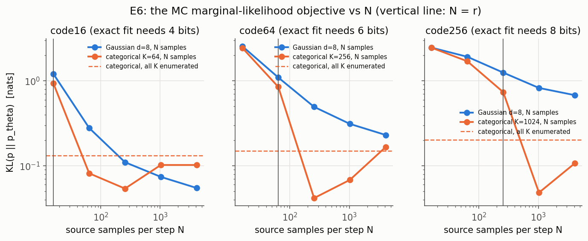
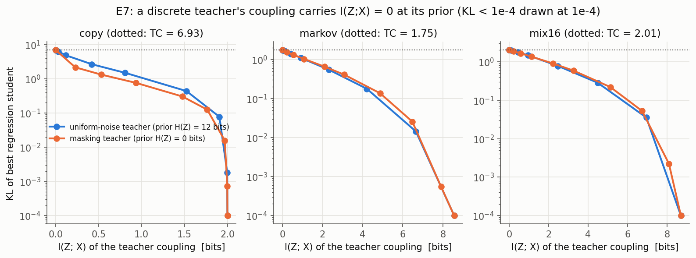
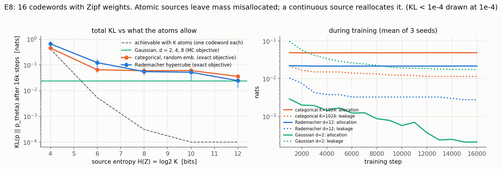

# Why one-step generators get their randomness from continuous noise

*A small mechanism study with exact metrics. V = 4 tokens, L = 6 positions, 4,096 states, so every
distribution is enumerated (no FID, no perplexity). Plan: [`one_step_discrete_plan.md`](one_step_discrete_plan.md).*

## The question

A one-step generator draws a source sample Z, runs one forward pass, and samples every position
independently: p_θ(x) = E_Z ∏ᵢ p_θ(xᵢ | Z). Every correlation between positions must be carried
by Z. Every one-step generator that works well gets Z from **continuous** noise. So:

> What exactly is missing from a discrete source of randomness? How much of it is
> information theory (a hard limit), and how much is geometry and optimization (a soft limit)?

## The answer

Information theory gives a hard limit, and it is real but cheap. A uniform source needs at least
rank(p) atoms, i.e. log₂K ≥ log₂ rank bits. (For non-uniform sources the general Shannon bound is
Wyner's common information, which is ≤ log₂ rank.) Below that every source fails alike. Above it, **representation is not the problem**:
with K atoms the achievable KL is tiny, and on an equal-weight mixture the best discrete sources
(well-separated atoms) fit *better* than Gaussian. The plan's main conjecture H4 is **falsified as
stated**. What discrete noise lacks is what one-step *training* relies on:

1. **Mass that can move between modes.** With a continuous source, the mass on a mode is
   P(z ∈ region_θ), which moves by sliding boundaries. Training drives the allocation error to
   about 2·10⁻⁴ nats, around half of which is evaluation noise. With an atomic source, moving mass
   means moving whole atoms. In the hard-assignment limit the mode masses are piecewise constant
   in θ. With softmax outputs, an atom moving between codewords must cross product distributions
   that leak onto non-codewords, and saturated atoms have vanishing gradients. Empirically the
   allocation error is **flat (within ±6%) from step 1k to step 16k**. For K ≥ 64 atoms, total KL
   stays **12× to more than 10⁴× above what the atoms could achieve**. On unequal weights the
   best Gaussian (d = 2, 0.018) fits better than every finite source. *(E8)*
2. **A deterministic noise → data transport to learn from.** At scale, one-step generators are
   trained by regressing onto a coupling (z, x) from a teacher or an encoder, because the
   likelihood needs ~2^I(X;Z) source samples per step *(E6)*. Generative teachers are built by
   *marginalizing* a path between independent noise and data. The two state spaces then behave
   differently:
   * **Continuous space.** Averaging the conditional velocities gives one vector field, and ODE
     trajectories cannot branch. The teacher's noise → data map is therefore deterministic for
     free (for argmax-decoded tokens, I(Z;X) = H(X)).
   * **Finite space.** Averaging the conditional rates gives a CTMC that can jump from one state
     to several targets. It branches, so the coupling is **stochastic**:
     * the time-reversed noising chain started from its prior keeps nothing: **I(Z;X) = 0**, and
       the student's KL = TC(p) exactly, even with H(Z) = 12 bits;
     * an exact **Discrete Flow Matching** teacher keeps a little: ~1.3 of ~8.6 bits on mix16
       and Markov, with student KL 1.07–1.41 vs TC 1.75–2.01.

   Deterministic discrete couplings do exist: an inverse-CDF sampler driven by Z, OT
   assignments, special CTMCs, iterative rectification as in ReDi. But they have to be
   *constructed* rather than obtained by marginalization, and they are only useful when the
   source geometry is aligned with them (point 3). *(E7, E7b)*
3. **Geometry aligned with that transport**, so the coupling is learnable on unseen z.
   Discreteness itself costs nothing here. On Markov data, an ordered 64-level grid of inverse-CDF
   uniforms matches continuous uniforms (held-out token accuracy 0.865 vs 0.858), and per-position
   tokens aligned by Hamming-OT match a Gaussian OT coupling. The *same source
   law* with its levels shuffled falls to the best z-independent baseline (0.368 vs 0.379). *(E4)*

So "one-step should be continuous" means: the source should be **atomless** so mass can flow; the
training coupling should come from a **deterministic transport**, which continuous-state
marginalization provides for free and discrete marginalization does not; and the noise needs
**geometry aligned with that transport**. Continuous noise
gives all three for free. Discrete noise supplies bits, but none of these by default.

| | hard (information) | soft (optimization / geometry) |
|---|---|---|
| what limits | K ≥ rank(p) atoms for a uniform source (Wyner's common information in general). Below it every source fails (E1, E3). | mass allocation (E8); information *in the training coupling* (E7); coupling learnability (E4) |
| binding in practice? | only for mask-type noise (H(Z) = 0 ⇒ KL = TC exactly) | yes: these separate discrete from continuous |
| continuous noise fixes it by | n/a | atomless source ⇒ mass moves with boundaries; ODE ⇒ deterministic coupling; metric ⇒ smooth coupling |

Note one subtlety. Point 2 *is* information-theoretic, but the binding quantity is the mutual
information **I(Z;X) of the training coupling**, not the entropy H(Z) of the source.

---

## Setup (shared harness)

* **Data**:
  * `mix<r>`: uniform mixture of r random product distributions, Dirichlet(0.2) rows, so
    I(C;X) ≈ log₂ r;
  * `markov`: first-order chain;
  * `copy`: x₁ = … = x₆;
  * `code<r>`: r codewords of the distance-2 parity code, so rank = r exactly;
  * `zipf16`: 16 such codewords with Zipf weights.
* **Generator**: MLP z → 256 → 256 → 6×4 logits, SiLU, Adam 1e-3 with cosine decay.
* **Objective** (identical for every source within an experiment): −Σₓ w(x) log (1/N) Σₙ ∏ᵢ p_θ(xᵢ|zₙ),
  with w = p (population) or the empirical distribution of n samples. E3 uses N = 256 fresh source
  samples per step; E3b, E6, and E8 vary N or enumerate all atoms, as stated. E4 instead uses
  supervised regression (CE) on fixed pairs.
* **Metrics**: KL(p‖p_θ), TV, TC(p_θ). They are exact for finite sources with K ≤ 2¹⁶ atoms. For
  continuous sources and larger K (including the H = 32 discrete sources) we use a 2¹⁶-sample MC
  estimate. Re-evaluating 151 MC runs with
  2¹⁴ samples changes KL by a median of 0.5% (90th percentile 3%, max 10%), i.e. an implied bias
  of ≤ 3.4% (median 0.2%).
* Each run writes one JSON (config, metrics, trajectory, wall time). Figures are built from the
  JSONs only (`onestep-discrete/plots.py`). E3b and E6 use one seed, E7 and E7b are exact computations,
  and everything else uses 3 seeds.

---

## Results

### H1: rank threshold. Confirmed (E1)

Population EM for a k-component mixture of products, best of 10 restarts.


* At k = 1, KL = TC(p) to machine precision (mix16: 2.012882 vs 2.012882). The neural generator
  with a constant source gives the same to < 1e-4 on mix16, markov, and copy (milestone 1
  passed).
* KL falls until k = r and is ≤ 3·10⁻⁶ for every k > r. At k = r exactly it is ~0 for
  r = 2, 4, 16 but 0.003 for mix64: EM local optima.
* Single restarts at k = r often get stuck (mix16: 0.03–0.11), while k = 1.5r reaches 0 from
  every restart. Assigning mass to components is already the hard part, which previews E8.

### H2: steps are self-made shared randomness. Confirmed (E2)

A masked-diffusion MLP is trained on each family. The k-step sampler's law is computed **exactly**
by summing over all ordered unmasking partitions. The oracle uses p's exact conditionals.


| KL (nats), MDM / oracle | k=1 | k=2 | k=3 | k=6 |
|---|---|---|---|---|
| markov | 1.753 / 1.753 | 0.352 / 0.349 | 0.114 / 0.111 | 0.0006 / 0 |
| copy | 6.931 / 6.931 | 2.773 / 2.773 | 1.386 / 1.386 | 0.0001 / 0 |
| mix16 | 2.013 / 2.013 | 0.42 / 0.36 | 0.17 / 0.12 | 0.034 / 0 |

At k = 1 the all-mask source has H(Z) = 0, so the sampler is a product and KL = TC exactly. Each
extra step lets committed tokens act as shared randomness. The oracle reaches 0 at k = L; the
trained MDM reaches it up to its own conditional-fit error.

### H4 as stated: falsified (E3)

Same generator, same objective; only P_Z changes, swept by source entropy H(Z).


**Population objective (mix16, threshold log₂ r = 4 bits), mean of 3 seeds, 4k steps:**

* Below 4 bits every source fails alike: 1.74–1.75 / 1.22–1.24 / 0.67–0.68 nats at
  H = 1 / 2 / 3. This is the information limit.
* Above it, the sources split, but in the **opposite** direction to H4. The best are
  well-separated atoms: one-hot levels 0.0004–0.010, categorical K = 256 0.003, and
  Rademacher d = 4–12 0.008–0.014. Ordered dense sources are worse: quantized m = 16 at
  0.05–0.06 for H ≥ 8 (0.15 at H = 4), and best-d Gaussian 0.055 and uniform 0.045. Not every
  discrete source wins: dense grids with few dimensions (quantized m = 256: 0.23 at H = 8) and huge
  K (categorical K = 2¹⁶: 0.061) do worse than Gaussian.
* The plateau of smooth sources is slow optimization, not capacity: a smooth network must build
  sharp boundaries. With 16k steps and N = 1024 (one seed): Gaussian 0.012, quantized m16 0.013,
  Rademacher d = 32 (2³² atoms) 0.012, vs Rademacher d = 4 5·10⁻⁵, one-hot 0.0009, categorical
  0.0012 (E3b).
* With far more atoms than are ever sampled (H = 32), every discrete source behaves like a
  continuous one (0.04–0.06).
* "Shuffled quantized" (levels permuted per dimension) is the **same distribution** as quantized,
  because a uniform law over the same points is just relabeled. As expected, it matches (mean of
  3 seeds: 0.147 vs 0.149 at d = 1; 0.059 vs 0.056 at d = 2). It cannot test "order" here. Order
  only matters once something else, a coupling, refers to it (E4).

**Generalization (train on n = 500 samples, exact KL to the true p):** H4 as stated is not
supported here either. Rademacher (geometry, in the plan's sense) generalizes as badly as
unordered one-hot (0.81–0.96 vs 0.77–0.99 for H = 6–16). Categorical with random 32-D embeddings
("no geometry" in the plan) matches Gaussian at H = 16 (0.416 vs 0.415). What helps is
**density**: many levels per dimension or many atoms relative to n.

* Quantized m = 16: 0.44–0.61, and quantized m = 4: 0.43–0.72, over H = 8–16.
* Gaussian and uniform reach ~0.42, and every source ends near there at H = 32 (0.42–0.46).
* The worst point above the threshold is H = 6 (K = 64): 0.95–0.99 for every family.

### H3: shared decision boundaries. Supported, but not unique to continuous noise (toy E5)

Take trained generators and move z a little: spherical interpolation for Gaussian d = 4, single
bit flips for Rademacher d = 8. Record which positions change their argmax, and compute
lift_ij = P(j flips | i flips) / P(j flips).

* **Markov** (MI decays with distance):
  * Gaussian z: adjacent positions co-flip **6.7–8.3×** more than chance; distant pairs (≥ 3
    apart) average 0.7–1.6× by seed. Spearman(lift, I(xᵢ;xⱼ)) = 0.65–0.85.
  * Rademacher hypercube: the same ordering, at lower magnitude (adjacent 2.1×, distant
    0.6–0.8×, ρ = 0.93–0.95).
* **mix16**: every pair is dependent (MI 0.035–0.16 nats) through the shared component. Co-flipping
  is broad: mean lift 2.1–2.5 (Gaussian) and 1.6 (hypercube), with a weaker rank correlation to MI
  (ρ = 0.05–0.39).

Correlation is carried by shared boundaries in any source with neighborhood structure. The
real-checkpoint probe (FMLM on LM1B) was not run. It needs an external checkpoint, and the toy
version answers the mechanistic question.

---

## Why discrete fails in practice: six candidate explanations, each tested

| # | candidate | verdict | evidence |
|---|---|---|---|
| 1 | not enough bits | **real but cheap**; binding only for mask-type noise | E1, E3 |
| 2 | discrete sources cannot represent the data | **no**; K atoms can represent it almost exactly | E3, E3b, E8 |
| 3 | the likelihood objective does not scale | **true for every source** (continuous is worse), so practice uses couplings | E6 |
| 4 | discrete teachers give poor couplings | **yes, for marginalized (independent-coupling) teachers**: I = 0 for the reversed chain, partial for DFM | E7, E7b |
| 5 | discrete couplings are not learnable | **only without aligned geometry**; ordered discrete = continuous | E4 |
| 6 | atomic sources cannot reallocate mass | **yes**: allocation flat for atoms, → 0 for continuous | E8 |

### (3) The MC marginal likelihood needs N ≳ 2^I source samples per step (E6)

On `code<r>` (exact fit needs log₂ r bits), the objective only sees a codeword when one of the N
source samples lands in its 1/r slice of source space. One seed per cell.



* N ≤ r fails for every source (KL 0.74–2.55).
* Gaussian improves steadily with N but needs N ≫ r: code256 is still at 0.68 with N = 4,096.
* A finite source with K = 4r atoms does best near N ≈ K (code256: 0.048).
* The exact *enumerated* objective is worse (0.13–0.20) with flat trajectories. Resampling atoms
  stochastically helps unstick them, which previews E8.
* At scale, I(X;Z) is hundreds of bits, so no N suffices. Practical one-step methods therefore
  regress onto a **coupling** (a teacher's ODE, an encoder, distillation), which moves the question
  to (4) and (5).
* Side note: on `code1024` (the full parity code, where any 5 positions are independent), *every*
  source and every N stays exactly at the product solution, KL = TC = log 4. With no low-order
  signal, gradients never leave the product. This is parity hardness and is independent of the
  source.

### (4) What a discrete teacher's coupling gives a one-step student (E7, E7b; exact)

A regression-optimal one-step student trained on a coupling π(z, x) learns q(xᵢ|z) = π(xᵢ|z) and
generates p_G(x) = Σ_z π(z) ∏ᵢ q(xᵢ|z). We compute it exactly for two teachers.

* **E7: forward joints** π(z, x) = p(x) ∏ᵢ k_α(zᵢ|xᵢ) with uniform or masking kernels. At α = 0
  this is the time-reversed noising chain started from its prior. For α > 0 it corresponds to
  starting the reversed chain from the α-marginal, which is *not* the prior.
* **E7b: Discrete Flow Matching teacher.** This is the marginal CTMC of the mixture path, started
  from Uniform(V^L), with rates P(X₁ᵢ = y | X_t)/(1−t). We integrate the forward Kolmogorov equation
  for the joint of (X₀, X_t) over all 4,096 × 4,096 pairs (Euler in s = −log(1−t), step 0.0025).
  The marginal matches p_t to ≤ 9·10⁻⁴ TV, checked every 20 steps. Doubling the step changes the
  student KL by ≤ 0.007 nats and I by ≤ 0.005 bits.



| teacher (prior noise) | H(Z) | I(Z;X): mix16 / markov / copy | student KL: mix16 / markov / copy |
|---|---|---|---|
| reversed noising chain (uniform prior) | 12 bits | **0 / 0 / 0** | 2.013 / 1.753 / 6.931 (= TC) |
| reversed masking chain (all-mask prior) | 0 bits | 0 / 0 / 0 | = TC |
| DFM marginal CTMC (uniform prior) | 12 bits | 1.31 / 1.25 / 0.64 | 1.41 / 1.07 / 2.14 |
| *deterministic coupling (e.g. ODE + argmax)* | | *= H(X): 8.7 / 8.6 / 2.0* | *→ 0* |

* Twelve bits of prior noise give nothing through the reversed chain. A DFM teacher recovers
  30–69% of TC, but its coupling is still stochastic, so a one-step student cannot get close.
* The student's error is mostly a function of the coupling's I(Z;X). On mix16 and Markov the DFM
  points sit 10–14% above the forward-joint curves at the same I. On copy the masking kernel is
  1.2–1.7× better than the uniform kernel at equal I, because one unmasked token pins the whole
  sequence.
* Why marginalized discrete teachers are stochastic: a teacher is built by averaging conditional
  dynamics over an independent coupling of noise and data. In continuous space the average is a
  velocity field, ODE trajectories cannot branch, and the endpoint map is deterministic.
  Continuous diffusion's SDE sampler is as uninformative as the reversed chain
  (I(Z_T; X₀) → 0), but its probability-flow ODE has the same marginals and a deterministic
  coupling. That is what consistency models, flow maps, MeanFlow, FMLM, and Duo distill. In a
  finite space the average is a jump-rate matrix: from one state the chain can jump to several
  targets, so the endpoint is random given the start.
* Deterministic discrete couplings are possible, but they must be built rather than inherited.
  Examples: E4's inverse-CDF (KR) map, which moves the sampler's per-step uniforms into Z;
  OT assignments; CTMCs whose state remembers the start (an independent reviewer gave one that
  maps uniform noise to `copy` deterministically); and iterative rectification as in ReDi. Such
  couplings are only learnable when the source geometry is aligned with them (E4).

### (5) A deterministic coupling is learnable iff the source geometry is aligned with it (E4)

Fit G by regression (CE) on 3,276 fixed (z, x) pairs; test on 820 held-out z (pairs shuffled
before the split).

* "code" = 4,096 symbols written as per-position tokens, the representation of uniform-diffusion
  noise.
* "kr" = the Knothe–Rosenblatt map: an autoregressive inverse-CDF sampler driven by u ∈ [0,1]⁶,
  i.e. a discrete multi-step sampler whose randomness has been moved into Z.
* Reference points: matching an independent sample gives 0.30 / 0.27 (markov / mix16); the best
  z-independent predictor (per-position majority token) gives 0.38 / 0.35.


| held-out token acc (markov / mix16) | random | VAE | OT | ODE | KR |
|---|---|---|---|---|---|
| Gaussian / uniform (continuous) | 0.30 / 0.27 | 0.71 / 0.69 | 0.82 / 0.77 | **0.91 / 0.90** | 0.86 / 0.82 |
| code (discrete tokens, Hamming-OT) | 0.31 / 0.28 | | **0.85 / 0.84** | | |
| quantized u, 64 ordered levels (discrete) | | | | | **0.87 / 0.82** |
| one-hot symbols (no geometry) | 0.37 / 0.33 | | 0.37 / 0.33 | | |
| shuffled u levels (same law as quantized) | | | | | **0.37 / 0.33** |

* **The coupling must be geometric.** Random pairs are memorized and do not generalize (the
  independent-match level). The plan predicted ODE ≈ VAE > Hamming-OT > random; observed is
  ODE > Hamming-OT ≈ Gaussian OT > VAE > random. The simplified VAE coupling is the weakest
  geometric one.
* **Discreteness is free.** Ordered 64-level u ≈ continuous u, and Hamming-OT code ≈ Gaussian OT.
* **Geometry is not free.** The *same pairs* fed through one-hot symbols, or the *same source law*
  with shuffled levels, fall to the z-independent baseline on held-out z. At scale the generator
  never sees most z, so this is decisive.

### (6) Atomic sources leave mass misallocated; continuous sources reallocate it (E8)

On `zipf16`, the exact KL splits as **allocation error** (KL of p against p_θ restricted to the
codewords and renormalized) plus **leakage** (−log p_θ(codewords)). Finite sources are trained
with the *exact* enumerated objective, the most favorable case. Gaussian uses MC with N = 1,024.
16k steps, 3 seeds. "Achievable" assigns each of the K atoms sharply to one codeword, which is an
upper bound on the best total KL with K atoms.



| source | total KL | achievable with K atoms | allocation @1k → @16k | leakage @1k → @16k |
|---|---|---|---|---|
| categorical K = 16 / 64 / 256 / 1024 / 4096 | 0.454 / 0.065 / 0.059 / 0.060 / 0.036 | 0.41 / 0.0054 / 3·10⁻⁴ / 2·10⁻⁵ / 10⁻⁶ | 0.28 / 0.065 / 0.055 / 0.049 / 0.028 → same ±6% | 0.17 / 0.000 / 0.011 / 0.022 / 0.021 → 0.17 / 0.000 / 0.003 / 0.011 / 0.008 |
| Rademacher d = 4 / 6 / 8 / 10 / 12 | 0.659 / 0.123 / 0.055 / 0.052 / 0.024 | same as K = 2^d | 0.45 / 0.12 / 0.053 / 0.050 / 0.022 → same ±6% | 0.21 / 0.006 / 0.006 / 0.006 / 0.010 → 0.21 / 0.005 / 0.003 / 0.001 / 0.003 |
| Gaussian d = 2 / 4 / 8 | **0.018 / 0.027 / 0.027** | n/a | 0.003 / 0.004 / 0.005 → **0.0002 / 0.0003 / 0.0003** | 0.10 / 0.12 / 0.13 → 0.018 / 0.027 / 0.026 |

* Finite sources settle their mass allocation in the first 1k steps and then barely move it. For
  K ≥ 64 their total KL is 12× (K = 64) to more than 10⁴× (K = 4096) above what their atoms could
  achieve. At K = 16 the gap is 1.1–1.6×, and two categorical seeds even beat the achievable value
  by spreading atoms over codewords: it is an upper bound on the optimum, not a lower bound.
* The Gaussian source gets the allocation right. Its residual allocation error (~2·10⁻⁴) is about
  half evaluation noise: the multinomial bias of a 2¹⁶-sample estimate over 16 modes is ≈1.1·10⁻⁴.
  All its remaining error is boundary leakage, which keeps shrinking. On total KL, Gaussian d = 2
  (0.018) beats every finite source. Rademacher d = 12 (0.024) beats Gaussian d = 4 and 8
  (0.027).
* Mechanism. For a continuous source with a density, the hard-partition mass P(z ∈ R_c(θ)) has a
  derivative equal to the flux of source density through the moving boundary ∂R_c, so mass flows
  under gradient descent. For an atomic source that quantity is piecewise constant. With soft
  outputs it is differentiable, but moving an atom from one codeword to another (Hamming
  distance ≥ 2) crosses product distributions that leak onto non-codewords, a loss barrier, and
  saturated atoms have vanishing gradients. In practice atoms stay where they first land. The
  same thing appears as EM local optima at k = r (E1) and as stuck exact objectives (E6).

---

## What this means for building one-step discrete generators

* **Bits are not the issue.** Uniform-token noise has L·log₂V bits, far more than needed.
  Mask-type noise has 0 bits, which is why one-step MDM sampling is a product (KL = TC).
* **Learn from a deterministic transport, and put the noise where mass can move.** Continuous noise
  with an ODE-derived coupling provides both. This is why FMLM, Categorical Flow Maps, Duo (argmax
  of a Gaussian diffusion), and Coupling Models (Gaussian latent → factorized decoder) work.
* **If the noise must be discrete, make it dense and ordered, aligned with the coupling.**
  Quantized uniforms driving an inverse-CDF sampler, or Hamming-OT-aligned tokens, are as learnable
  as continuous noise. Unordered symbols are not.
* **A marginalized discrete teacher is a weak source of couplings.** Its reversed chain gives
  I(Z;X) = 0 at the prior, and even an exact DFM teacher keeps only ~1.3 of ~8.6 bits. Build
  the coupling instead (OT, inverse-CDF, rectification), with aligned geometry.

## Limitations

* Toy scale: L = 6, V = 4, one MLP architecture, fixed budgets (4k–16k steps). Effects that only
  appear at scale (attention, long sequences) are not tested.
* E3b and E6 use one seed. E7b is deterministic; its Euler discretization moves the reported
  numbers by ≤ 0.007 nats and ≤ 0.005 bits.
* E4 trains G on 3,276 pairs, so its deployed KL is dominated by memorization and the held-out law
  uses only 820 atoms for code/one-hot. We report held-out accuracy as the learnability metric.
  The FM teacher in E4 is imperfect on mix16 (target TV 0.36 vs a 0.18 sampling floor); an
  independent check traced this to velocity-fit error, not the ODE.
* The E5 real-model probe (FMLM on LM1B) was not run.
* E8 uses one data family (Zipf-weighted codewords). The mechanism is general; the magnitudes are
  specific.

## Reproduce

```bash
cd onestep-discrete            # any env with torch>=2.0 (CUDA optional), scipy, matplotlib
python sweeps/e1_rank.py       # E1  EM rank sweep               (~15 min GPU)
python sweeps/e2_steps.py      # E2  MDM k-step exact laws        (~5 min)
python sweeps/e3_sources.py --data mix16 --n_train 0     # E3 (~1.5 h; --worker/--nworkers to shard)
python sweeps/e3_sources.py --data mix16 --n_train 500
python sweeps/e3_budget.py     # E3b budget / N check
python sweeps/e4_coupling.py   # E4  coupling learnability        (~40 min)
python sweeps/e5_boundaries.py # E5  toy boundary probe
python sweeps/e6_nscaling.py   # E6  objective vs N
python sweeps/e7_teacher_coupling.py  # E7 exact, ~1 min
python sweeps/e7b_dfm.py       # E7b exact DFM teacher coupling   (~15 min)
python sweeps/e8_mass.py       # E8  mass allocation              (~40 min)
python plots.py                # all figures from results/*.json
```

The code and this report were checked three times by an independent agent, the last pass a full
fact-check of every number against the JSONs. Every verified finding was fixed; the fixes
include an E4 split order, categorical standardization, codebook rank, the DFM teacher
(added in response), the framing of the mass argument, and plotting. Affected experiments were
re-run. The git history is the research log.
