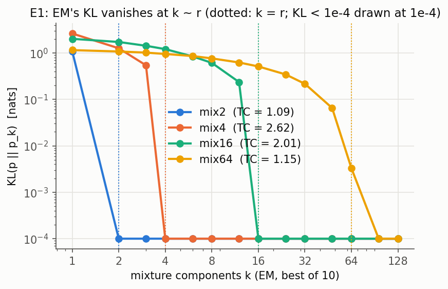
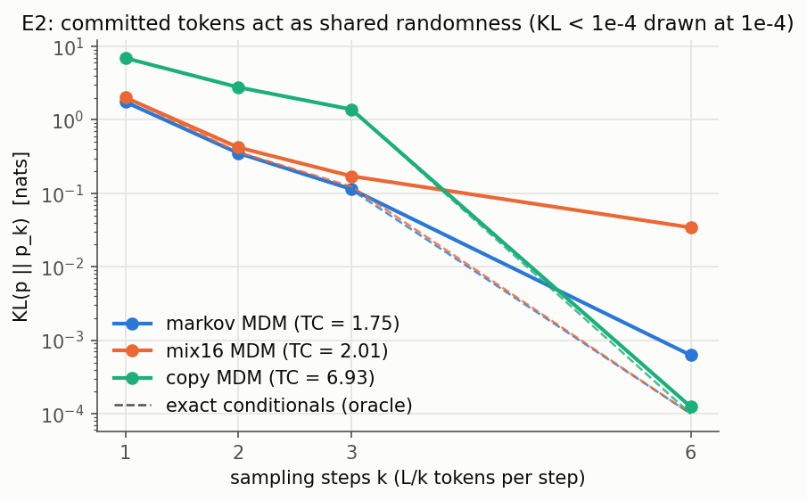
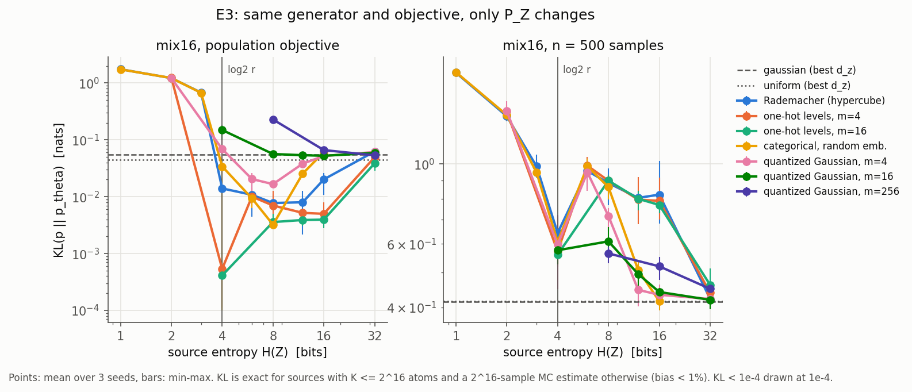
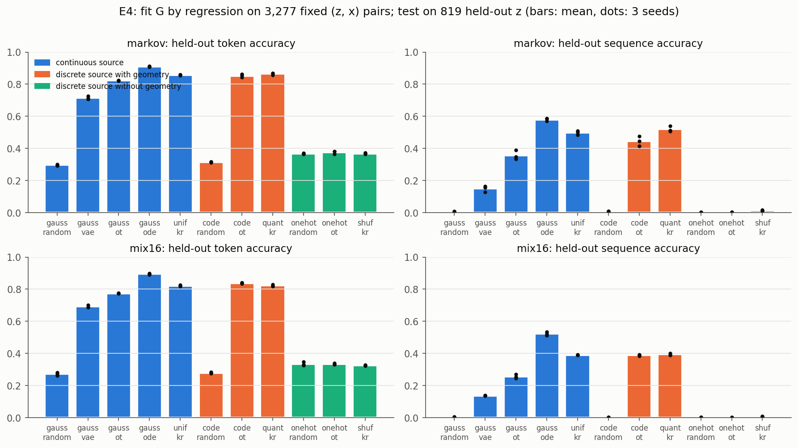

# Why one-step generators get their randomness from continuous noise

*A small, exactly-measured mechanism study. V = 4 tokens, L = 6 positions, 4,096 states, so every
KL below is computed by enumeration (no FID, no perplexity). Plan: [`one_step_discrete_plan.md`](one_step_discrete_plan.md).*

## The question

A one-step generator draws a source sample Z, runs one forward pass, and samples every position
independently: p_θ(x) = E_Z ∏ᵢ p_θ(xᵢ | Z). Every correlation between positions must be carried
by Z. Every one-step generator that works well gets Z from **continuous** noise. So:

> What exactly is missing from a discrete source of randomness? How much of it is
> information theory (a hard limit), and how much is geometry and optimization (a soft limit)?

## The answer in one paragraph

Information theory gives a hard limit, and it is real but cheap. Z must carry at least log₂(rank)
bits, and with that many bits **discrete sources fit the data as well as or better than Gaussian
ones**. So the plan's main conjecture (H4: discrete sources without geometry are worse) is
**falsified for fitting**. What discrete noise lacks is two kinds of continuity that one-step
*training* depends on:

1. **Mass must be able to flow.** With an atomic source, the probability a generator puts on a mode
   is (#atoms mapped there)/K. That is piecewise constant in the parameters, so gradient descent
   cannot move mass between modes: the allocation error is **frozen from step 1k to step 16k**.
   With an atomless source the mass is P(z ∈ region_θ), which is differentiable, so it flows to the
   right weights (error → 0.0002 nats). *(E8)*
2. **The noise → data map must be deterministic.** One-step generators are trained by regressing
   onto a coupling (z, x) from a teacher or an encoder. A continuous state space has a
   probability-flow ODE, a deterministic coupling with I(Z;X) = H(X). A finite state space has no
   such thing: a continuous path in a discrete space is constant, so every discrete
   diffusion/flow sampler must inject fresh randomness. Its coupling with its own prior noise
   carries **exactly I(Z;X) = 0**, even when H(Z) = 12 bits. A student distilled from it is a
   product distribution, so KL = TC(p), the same as having no noise at all. *(E7)*

Geometry is the soft part. A deterministic coupling is only *learnable* (it generalizes to unseen z)
if the source has an order or metric aligned with it. Discreteness itself costs nothing here: an
ordered 64-level grid matches continuous uniform noise (held-out token accuracy 0.865 vs 0.858).
The *same* source law with shuffled levels collapses to chance (0.368). *(E4)* The same holds for
generalizing from finite data *(E3, n = 500)*.

So "one-step should be continuous" really means three things. The generator needs an **atomless
source** so mass can move. It needs a **deterministic, smooth transport** from noise to data, which
only continuous paths provide. And the noise needs **geometry aligned with that transport**.
Continuous noise gives all three for free. Discrete noise can supply the bits but none of these by
default.

| | hard (information) | soft (geometry / optimization) |
|---|---|---|
| what limits | H(Z) ≥ log₂ rank(p). Below it every source fails (E1, E3). | mass allocation (E8), coupling information I(Z;X) (E7), coupling learnability (E4), generalization (E3) |
| binding in practice? | only for mask-type noise (H = 0 ⇒ KL = TC exactly) | yes: these are what separate discrete from continuous |
| continuous noise fixes it by | n/a | atomless ⇒ differentiable mass; ODE ⇒ deterministic coupling; metric ⇒ smooth coupling |

Note one subtlety. Point 2 *is* information-theoretic, but the binding quantity is the mutual
information **I(Z;X) of the training coupling**, not the entropy H(Z) of the source.

---

## Setup (shared harness)

* **Data**: `mix<r>` (uniform mixture of r random product distributions, Dirichlet(0.2) rows, so
  I(C;X) ≈ log₂ r), `markov` (first-order chain), `copy` (x₁ = … = x₆), `code<r>` (r codewords of a
  distance-2 parity code, so rank = r exactly), `zipf16` (16 codewords with Zipf weights).
* **Generator**: MLP z → 256 → 256 → 6×4 logits, SiLU, Adam 1e-3 with cosine decay.
* **Objective** (identical for every source): −Σₓ w(x) log (1/N) Σₙ ∏ᵢ p_θ(xᵢ|zₙ), with N = 256
  fresh source samples per step and w = p (population) or the empirical distribution of n samples.
* **Metrics**: exact KL(p‖p_θ), TV, TC(p_θ). They are exact for finite sources with K ≤ 2¹⁶ atoms.
  Otherwise we use a 2¹⁶-sample MC estimate, whose bias we checked: 0.2029 vs 0.2041 at a quarter
  of the samples.
* Each run writes one JSON (config, metrics, trajectory, wall time). Figures are built from JSONs
  only (`onestep-discrete/plots.py`).

---

## Results

### H1: rank threshold. Confirmed exactly (E1)

Population EM for a k-component mixture of products, best of 10 restarts.



* k = 1 gives KL = TC(p) to machine precision (mix16: 2.012882 vs 2.012882). The neural
  generator with a constant source gives the same to < 1e-4 on mix16, markov, and copy
  (milestone 1 passed).
* KL falls monotonically and reaches 0 at k = r for r = 2, 4, 16. For mix64 it is 0.003 at
  k = 64 and 0 for k ≥ 96.
* Even here optimization is not free: with exactly k = r, single EM restarts land in local
  optima (mix16: 0.03–0.11), while k = 1.5r reaches 0 from *every* restart. This is the first sign
  of the mass-allocation problem in E8.

### H2: steps are self-made shared randomness. Confirmed (E2)

A masked-diffusion MLP is trained on each family. The k-step sampler's law is computed **exactly**
by summing over all ordered unmasking partitions. The oracle uses p's exact conditionals.



| KL (nats) | k=1 | k=2 | k=3 | k=6 |
|---|---|---|---|---|
| markov MDM / oracle | 1.753 / 1.753 | 0.352 / 0.349 | 0.114 / 0.111 | 0.0006 / 0 |
| copy MDM / oracle | 6.931 / 6.931 | 2.773 / 2.773 | 1.386 / 1.386 | 0.0001 / 0 |
| mix16 MDM / oracle | 2.013 / 2.013 | 0.42 / 0.36 | 0.17 / 0.12 | 0.034 / 0 |

At k = 1 the all-mask source has H(Z) = 0, so the sampler is a product and KL = TC exactly. Each
extra step lets committed tokens serve as shared randomness.

### H4 as stated: falsified for fitting, partly supported for generalization (E3)

Same generator, same objective; only P_Z changes, swept by source entropy H(Z).



**Population objective (mix16, threshold log₂ r = 4 bits), mean of 3 seeds, 4k steps:**

* Below 4 bits *every* source fails identically (1.74 / 1.22 / 0.67 nats at H = 1 / 2 / 3).
  This is the information limit.
* Above it, the sources split, but in the **opposite** direction to H4. Structureless and
  well-separated atoms are best: one-hot levels 0.0004–0.010, categorical K = 256 0.003,
  Rademacher 0.008–0.014. Ordered dense sources are worse: quantized m = 16 0.05, Gaussian 0.055,
  uniform 0.045.
* The plateau of smooth sources is slow optimization, not a capacity limit. A smooth network has to
  build sharp boundaries. At 16k steps and N = 1024: Gaussian 0.012, quantized m16 0.013,
  Rademacher d = 32 (2³² atoms) 0.012, vs Rademacher d = 4 0.0001, one-hot 0.0009, categorical
  0.0012 (E3b).
* With many more atoms than are ever seen (H = 32) every discrete source behaves like a continuous
  one (0.04–0.06).
* "Shuffled quantized" (levels permuted per dimension) is the **same distribution** as quantized,
  because a uniform law over the same points is just relabeled. As expected it matches
  (mean of 3 seeds: 0.147 vs 0.149 at d = 1; 0.059 vs 0.056 at d = 2). It cannot test "order" in this setting. Order only matters
  once something else, a coupling, refers to it (E4).

**Generalization (train on n = 500 samples, exact KL to the true p):** everything overfits, but
the sources separate. At equal H between 8 and 16 bits, ordered sources beat unordered ones:
quantized m = 16 0.44–0.61 vs one-hot m = 16 0.77–0.90; quantized m = 4 0.43–0.72 vs
one-hot m = 4 0.79–0.90; Rademacher 0.80–0.88. Gaussian and uniform reach about 0.42, and every
source ends up near there at H = 32 (0.42–0.46). Categorical symbols with random 32-D embeddings
behave like the ordered sources once H ≥ 12 (0.51, 0.42); a random embedding is itself a point
cloud with a metric. The worst regime is K ≈ n, where each atom can memorize one training
sample.

### H3: shared decision boundaries. Supported, but not unique to continuous noise (toy E5)

Take trained generators and move z a little: spherical interpolation for Gaussian d = 4, single
bit flips for Rademacher d = 8. Record which positions change their argmax. Then compute
lift_ij = P(j flips | i flips) / P(j flips).

* **Markov** (MI decays with distance): with Gaussian z, adjacent positions co-flip **6.7–8.3×**
  more than chance and distant pairs ~1×. Spearman(lift, I(xᵢ;xⱼ)) = 0.65–0.85. A Rademacher
  hypercube shows the same structure (ρ = 0.93–0.95, adjacent lift 2.1×).
* **mix16** (all pairs equally dependent): uniform co-flipping (lift ~2 for all pairs), as it
  should be.

Correlation is carried by shared boundaries in *any* source with neighborhood structure. The
real-checkpoint probe (FMLM on LM1B) was not run. It needs an external checkpoint download, and the
toy version already answers the mechanistic question.

---

## Why discrete fails in practice: candidate explanations, each tested

Since H4 failed for fitting, the gap must be elsewhere. Five candidates:

| # | candidate | verdict | evidence |
|---|---|---|---|
| 1 | not enough bits | **real but cheap**; binding only for mask-type noise | E1, E3 |
| 2 | discrete sources cannot represent the data | **no**; they fit better | E3, E3b |
| 3 | the likelihood objective does not scale | **true for every source** (continuous is worse), so this is why practice uses couplings | E6 |
| 4 | discrete teachers give uninformative couplings | **yes: I(Z;X) = 0 at the prior** | E7 |
| 5 | discrete couplings are not learnable | **only without aligned geometry**; ordered discrete = continuous | E4 |
| 6 | atomic sources cannot move mass by gradient | **yes: allocation frozen; continuous → 0** | E8 |

### (3) The MC marginal likelihood needs N ≳ 2^I samples per step (E6)

On `code<r>` (exact fit needs log₂ r bits), the objective only sees a codeword when one of the N
source samples lands in its 1/r slice of source space.


* N ≤ r fails for every source (KL 0.74–2.55).
* Gaussian improves steadily with N but needs N ≫ r: code256 is still at 0.68 with N = 4,096.
* A finite source with K = 4r atoms does best near N ≈ K (code256: 0.048).
* Oddly, the **exact enumerated** objective is *worse* (0.13–0.20, flat trajectories). Stochastic
  resampling of atoms helps unstick them, which previews E8.
* At scale, I(X;Z) is hundreds of bits, so no N is enough. That is why practical one-step methods
  regress onto a **coupling** (a teacher's ODE, an encoder, distillation) rather than maximizing
  likelihood, and that moves the question to (4) and (5).
* Side note: on `code1024` (the full parity code, where any 5 positions are independent) *every*
  source and every N stays exactly at the product solution, KL = TC = log 4. With no low-order
  signal, gradients never leave the product. This is a parity-hardness phenomenon and is
  independent of the source.

### (4) A discrete teacher's coupling carries zero information (E7, exact)

A multi-step discrete sampler driven by the exact reverse process realizes the forward joint
π(z, x) = p(x) ∏ᵢ k_α(zᵢ|xᵢ). We compute, exactly, the regression-optimal one-step student from
that coupling: q(xᵢ|z) = π(xᵢ|z), giving p_G(x) = Σ_z π(z) ∏ᵢ q(xᵢ|z).


* At the true prior (α = 0) the uniform-noise teacher has H(Z) = **12 bits** but
  **I(Z;X) = 0**. The student's KL is **exactly TC(p)**: 2.013 on mix16, 1.753 on markov, 6.931 on
  copy. That is identical to the 0-bit all-mask source.
* Student error is governed by I(Z;X), not by H(Z) or the kernel. The uniform and masking
  curves nearly coincide when plotted against I.
* The reason is structural. A continuous path into a finite set is constant, so a finite state
  space has no probability-flow ODE; any change of the marginal needs random jumps, and the
  randomness consumed along the way never appears in Z. Continuous diffusion has the same
  problem for its SDE sampler, but it also has an ODE with the same marginals and a deterministic
  coupling. That is exactly what consistency models, flow maps, MeanFlow, FMLM, and Duo exploit.

### (5) A deterministic coupling is learnable iff the source geometry is aligned with it (E4)

Fit G by regression (CE) on 3,277 fixed (z, x) pairs; test on 819 held-out z.

* "code" = 4,096 symbols written as per-position tokens, the representation of uniform-diffusion
  noise.
* "kr" = the Knothe–Rosenblatt map: an autoregressive inverse-CDF sampler driven by u ∈ [0,1]⁶.
  This is exactly a discrete multi-step sampler whose randomness has been moved into Z.



| held-out token acc (markov / mix16) | random | VAE | OT | ODE | KR |
|---|---|---|---|---|---|
| Gaussian / uniform (continuous) | 0.30 / 0.27 | 0.72 / 0.69 | 0.82 / 0.77 | **0.91 / 0.90** | 0.86 / 0.82 |
| code (discrete tokens, Hamming-OT) | 0.31 / 0.28 | | **0.85 / 0.84** | | |
| quantized u, 64 ordered levels (discrete) | | | | | **0.87 / 0.82** |
| one-hot symbols (no geometry) | 0.37 / 0.33 | | 0.37 / 0.33 | | |
| shuffled u levels (same law as quantized) | | | | | **0.37 / 0.33** |

* The coupling has to be geometric: random pairs give chance accuracy for every source. The plan's
  expected ordering holds (ODE > OT > learned VAE > random).
* Discreteness is free: ordered 64-level u ≈ continuous u; Hamming-OT code ≈ Gaussian OT.
* Geometry is not free. The *same pairs* fed through one-hot symbols, or the *same source law*
  with shuffled levels, fall to chance on held-out z. At scale the generator never sees most z,
  so this is decisive.

### (6) Atoms freeze mass; continuous sources let it flow (E8)

On `zipf16` (16 codewords with Zipf weights), split the KL exactly into
**allocation error** KL(p ‖ p_θ restricted to the codewords) plus **leakage** −log p_θ(codewords).
Finite sources are trained with the *exact* enumerated objective (the most favorable case);
Gaussian uses MC N = 1,024; 16k steps, 3 seeds.


| source | allocation @1k → @16k | leakage @1k → @16k | best allocation possible with K atoms |
|---|---|---|---|
| categorical K = 64 / 256 / 1024 / 4096 | 0.065 / 0.055 / 0.049 / 0.028 → **unchanged** | → 0.000 / 0.003 / 0.012 / 0.008 | 0.005 / 3e-4 / 2e-5 / 1e-6 |
| Rademacher d = 6 / 8 / 10 / 12 | 0.118 / 0.053 / 0.050 / 0.022 → **unchanged** | → 0.005 / 0.003 / 0.001 / 0.003 | same |
| Gaussian d = 2 / 4 / 8 | 0.003 / 0.004 / 0.005 → **0.0002 / 0.0003 / 0.0003** | 0.10–0.13 → 0.018–0.027 | n/a |

Finite sources get their mass allocation wrong **in the first 1k steps and never fix it**, at
13× (K = 64) to more than 10⁴× (K = 4096) above what their atoms could represent. The Gaussian source gets the allocation right,
and its remaining error is boundary leakage, which keeps shrinking.

Mechanism: the mass on a mode is P(z ∈ R_c(θ)). For an atomless P_Z its derivative is the flux of
source density through the moving boundary ∂R_c, which is generically non-zero. For an atomic
P_Z it is a sum of indicators, which is piecewise constant. Moving mass then requires an atom to
cross over, passing through product distributions that leak onto non-codewords (a loss barrier).

---

## What this means for building one-step discrete generators

* **Bits are not the issue.** Uniform-token noise has L·log₂V bits, far more than needed.
  Mask-type noise has 0 bits, which is why one-step MDM sampling is a product (KL = TC).
* **Put the noise in a space where mass can flow and transport is deterministic.** Continuous
  noise with an ODE-derived coupling does both. This is why FMLM, Categorical Flow Maps, Duo
  (argmax of a Gaussian diffusion), and Coupling Models (Gaussian latent → factorized decoder)
  work.
* **If the noise must be discrete, give it order aligned with the coupling.** Quantized uniforms
  driving an inverse-CDF sampler (KR) or Hamming-OT-aligned tokens are as learnable as continuous
  noise. Unordered symbols are not.
* **Do not distill from a discrete teacher's own prior noise.** Its coupling carries I(Z;X) = 0
  however many bits the noise has.

## Limitations

* Toy scale: L = 6, V = 4, one MLP architecture, fixed budgets (4k–16k steps). Effects that only
  appear at scale (e.g. attention, very long sequences) are not tested.
* E4 trains G on only 3,277 pairs, so its *deployed* KL is dominated by memorization. We report
  held-out accuracy as the coupling-learnability metric.
* The FM teacher in E4 is imperfect on mix16 (target TV 0.36 vs a 0.18 sampling floor; an
  independent check traced this to velocity-fit error, not the ODE).
* E6 uses one seed per cell. The E5 real-model probe (FMLM on LM1B) was not run.
* E8 uses one data family (Zipf-weighted codewords). The mechanism argument is general, but the
  magnitudes are specific.

## Reproduce

```bash
cd onestep-discrete            # any env with torch>=2.0 (CUDA optional), scipy, matplotlib
python sweeps/e1_rank.py       # E1  EM rank sweep               (~15 min GPU)
python sweeps/e2_steps.py      # E2  MDM k-step exact laws        (~5 min)
python sweeps/e3_sources.py --data mix16 --n_train 0     # E3 (~1.5 h; --worker/--nworkers to shard)
python sweeps/e3_sources.py --data mix16 --n_train 500
python sweeps/e3_budget.py     # E3b budget / N check
python sweeps/e4_coupling.py   # E4  coupling learnability        (~40 min)
python sweeps/e5_boundaries.py # E5  toy boundary probe
python sweeps/e6_nscaling.py   # E6  objective vs N
python sweeps/e7_teacher_coupling.py  # E7 exact, ~1 min
python sweeps/e8_mass.py       # E8  mass allocation              (~40 min)
python plots.py                # all figures from results/*.json
```

All code and figures were independently reviewed twice by a second agent. The verified bugs it
found (an E4 split order, categorical standardization, codebook rank, plotting) were fixed and the
affected experiments re-run; see the git history.
